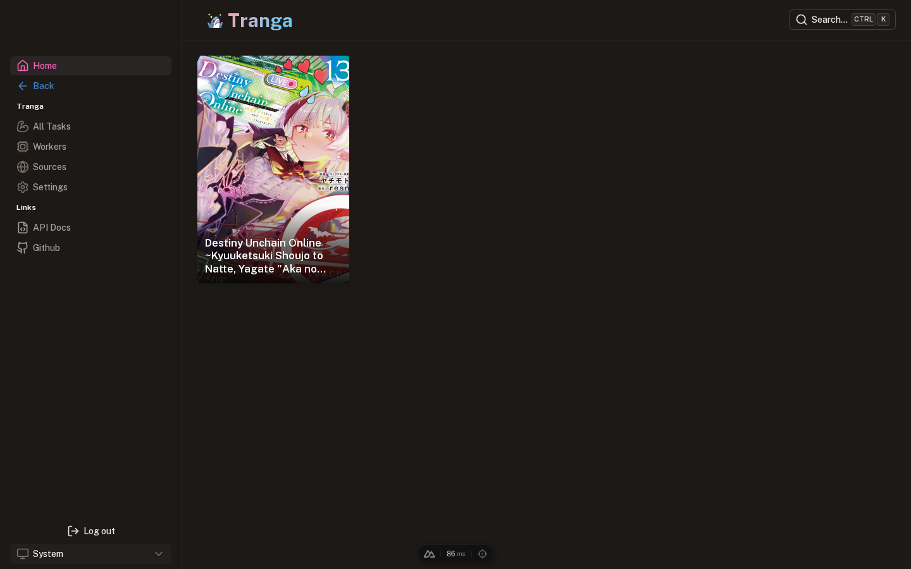
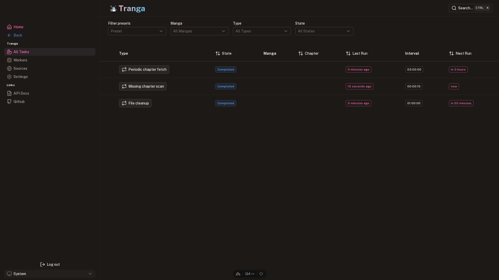
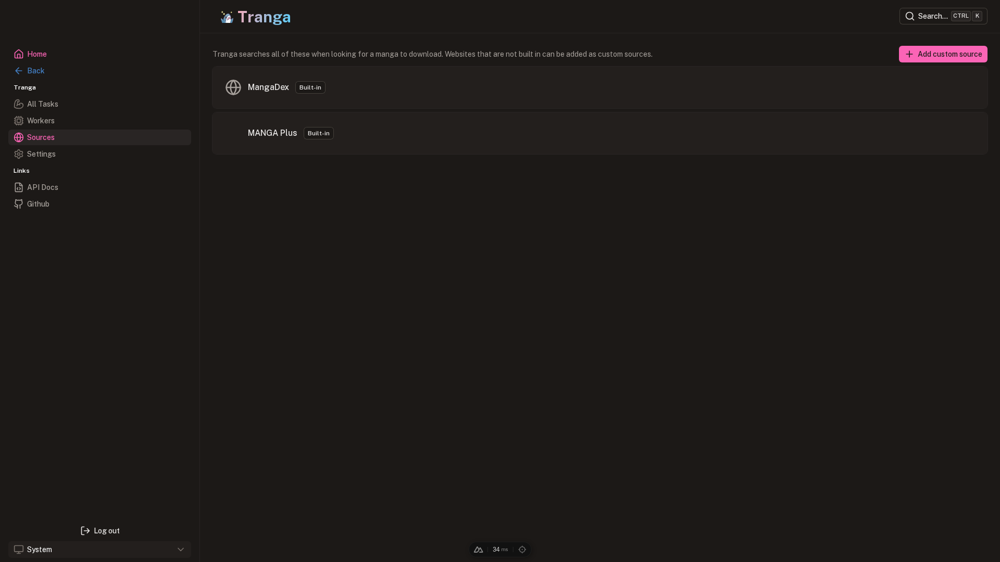
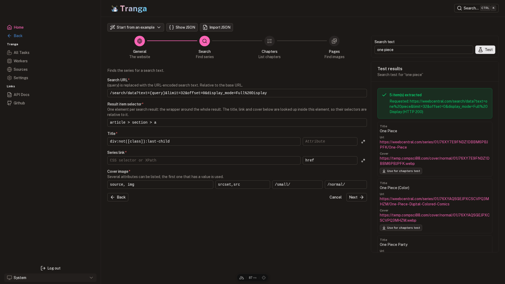

<span id="readme-top"></span>
<div align="center">

  <h1 align="center">Tranga</h1>
  <p align="center">
    Automatic Manga and Metadata downloader 
  </p>


  <table>
    <tr>
      <th></th>
      <td></td>
    </tr>
  </table>

</div>

## Features

- [x] Monitor providers for new chapters and download new ones
- [x] Enrich Manga and chapters with Metadata from third-party websites
- [x] Flaresolverr support
- [x] Notifications
  - Using [Naprise](https://github.com/Genteure/naprise)
    - Gotify
    - Telegram
    - Discord
    - Ntfy.sh
    - ...
- [x] Library support using [Komga](https://komga.org/) and [Kavita](https://www.kavitareader.com/)
  - Sync Metadata
  - Scan chapters
  - Sync Cover images
- [x] Modular download sources (built in: [MangaDex](https://api.mangadex.org/docs/) and [MANGA Plus](https://mangaplus.shueisha.co.jp))
- [x] Custom download sources: add a website with CSS/XPath selectors, no code needed (see [Custom sources](#custom-sources))

#### TODO LIST

- [ ] Unified webpage scraper ([Common/Helpers/RequestClient.cs](Common/Helpers/RequestClient.cs))
- [ ] Existing chapter mapping (`Services.Manga`)

## Getting started

- [docker-compose.yaml](Tranga.AppHost/aspire-output/docker-compose.yaml)
You probably do not want to modify this. Use the [`.env`](Tranga.AppHost/aspire-output/.env) file for configuration.
- [.env](Tranga.AppHost/aspire-output/.env)
  - [Environment variable documentation](EnvVars.md)

### Settings

All configuration that doesn't live in the [`.env`](Tranga.AppHost/aspire-output/.env) file is done in the web UI under **Settings**:

| Page              | What it does                                                                                                                                                                                  |
|-------------------|-----------------------------------------------------------------------------------------------------------------------------------------------------------------------------------------------|
| **Sources**       | See the built-in download sources (MangaDex, MANGA Plus) and add, edit or delete your own custom sources. |
| **Notifications** | Add notification extensions: Gotify, Discord, ntfy.sh, Telegram, or any other [Naprise](https://github.com/Genteure/naprise) service URL.                                                    |
| **Libraries**     | Connect [Komga](https://komga.org/) or [Kavita](https://www.kavitareader.com/) libraries (see [Adding a Komga library](#adding-a-komga-library) and [Adding a Kavita library](#adding-a-kavita-library)).                                         |
| **Appearance**    | Choose how covers of NSFW manga are displayed: always visible, visible on click, or never visible (blurred).                                                                                  |
| **Security**      | Create and revoke API keys (only relevant when `UseAuth` is enabled).                                                                                                                         |
| **About**         | Shows version and git commit of every running service.                                                                                                                                        |

The Settings overview additionally offers **Replay first-download tour** (restarts the guided walkthrough) and
**Backfill ComicInfo for downloaded chapters** (creates a task that adds `ComicInfo.xml` to already downloaded chapters; progress is shown on the Tasks page).

### Custom sources

Under **Settings → Sources → Add custom source** you can teach Tranga a website by pasting selectors, no code needed.
The form is a stepper: **General** (the website itself) followed by the three steps below. Each of those steps is tried from
the testing sidebar on the right: enter a search text, a series URL or a chapter URL and press **Test**. The step runs against
the real website and the sidebar shows what the selectors extracted, so you can fix them before saving. The buttons next to a
search or chapter result fill in the test of the next step. The source can only be created on the last step.

1. **Search**: a URL (`{query}` is the URL-encoded search text), a selector for one element per result, and fields for
   title, link and cover image.
2. **Chapters**: the page listing the chapters (by default the series page; `{url}` is the series link), a selector for
   one element per chapter, and fields for link and number (optionally title and release date). A "next page" link is
   followed if the list is paginated.
3. **Pages**: the page that shows a chapter's images (by default the chapter page) and a selector for the images. Some
   sites show only one image per web page; for those, add **Page links** (the links, or the options of a page dropdown,
   that lead to every page of the chapter, in reading order). Every page is then opened and the image selector is applied
   to it. A chapter fails (and is retried later) if one of its pages cannot be loaded or has no image.

A *field* is a selector (CSS or XPath, detected automatically; empty = the item itself), an attribute to read (empty = the
text; `srcset,src` tries several), and optionally a regular expression (the first group is kept, or with "Replace with"
every match is replaced). Selectors of fields are relative to their item, XPaths copied from the browser (`//div/a`) work too.
CSS supports `:not()`, `:has()`, `:contains()` and the other usual selectors. Relative links are resolved for you.

The **General** step holds the name, the base URL (a trailing `/` is removed), an icon, the languages (codes such as `en`,
`en-us` or `pt-BR`), a series URL pattern (named groups such as `(?<id>[^/]+)` can be used as `{id}` in the chapter and page
URLs; try it on a URL in the sidebar to see whether it matches and which groups it captures), request headers (e.g. `Cookie`;
requests look like a regular browser unless you set a `User-Agent`), a rate limit, and whether to use FlareSolverr.

**Start from an example** fills the form with a built-in definition. **Show JSON** displays the source as JSON (with a Copy
button) and **Import JSON** fills the form from a pasted definition, so sources can be shared.

Good to know:

- The data has to be in the HTML the server sends. Pages that build their content with JavaScript do not work (FlareSolverr
  only helps with Cloudflare challenges).
- Chapters without a number in their name are skipped; the first number found is used, so use a regex if a name contains
  several (e.g. `(\d+(?:\.\d+)?)\s*$` takes the last one).
- For safety, custom sources may only reach public websites: loopback, LAN and link-local addresses are refused. Set
  `ALLOW_PRIVATE_SOURCE_HOSTS=true` ([EnvVars.md](EnvVars.md)) for a source on your own network.

The **WeebCentral** definition below is built in as an example ("Start from an example") and mirrors the
[keiyoushi](https://github.com/keiyoushi/extensions-source/tree/main/src/en/weebcentral) extension. The chapter list does not
live on the series page but at `/series/{id}/full-chapter-list`, which is what the series URL pattern is for:

```json
{
  "name": "WeebCentral",
  "baseUrl": "https://weebcentral.com",
  "languages": ["en"],
  "requestsPerSecond": 0.5,
  "seriesUrlPattern": "^https://weebcentral\\.com/series/(?<id>[^/?#]+)",
  "search": {
    "urlTemplate": "/search/data?text={query}&limit=32&offset=0&display_mode=Full%20Display",
    "itemSelector": "article > section > a",
    "title": { "selector": "div:not([class]):last-child" },
    "url": { "attribute": "href" },
    "cover": { "selector": "source, img", "attribute": "srcset,src", "regex": "/small/", "replacement": "/normal/" }
  },
  "chapters": {
    "urlTemplate": "/series/{id}/full-chapter-list",
    "itemSelector": "div[x-data] > a",
    "url": { "attribute": "href" },
    "number": { "selector": "span.flex > span", "regex": "(\\d+(?:\\.\\d+)?)\\s*$" },
    "date": { "selector": "time[datetime]", "attribute": "datetime" }
  },
  "images": {
    "urlTemplate": "{url}/images?is_prev=False&reading_style=long_strip",
    "imageSelector": "section[x-data*=scroll] > img",
    "attribute": "src"
  }
}
```

**MangaTown** is built in as a second example and mirrors the
[keiyoushi](https://github.com/keiyoushi/extensions-source/tree/main/src/en/mangatown) extension. It is built differently
from WeebCentral, which shows what the selectors can do: the chapters are listed on the series page, their number is only
in the link (`/manga/vagabond/v33/c327/` is chapter 327, not volume 33), the title is an XPath, and every page of a chapter is
its own web page that is found through the page dropdown. Dates such as "Today" cannot be parsed with a date format and stay
unknown.

```json
{
  "name": "MangaTown",
  "baseUrl": "https://www.mangatown.com",
  "languages": ["en"],
  "requestsPerSecond": 2,
  "seriesUrlPattern": "^https?://(?:www\\.)?mangatown\\.com/manga/(?<id>[^/?#]+)/?$",
  "search": {
    "urlTemplate": "/search?name={query}",
    "itemSelector": "li:has(a.manga_cover)",
    "title": { "selector": "p.title a" },
    "url": { "selector": "p.title a", "attribute": "href" },
    "cover": { "selector": "img", "attribute": "src" }
  },
  "chapters": {
    "itemSelector": "ul.chapter_list li",
    "url": { "selector": "a", "attribute": "href" },
    "number": { "selector": "a", "attribute": "href", "regex": "/c(\\d+(?:\\.\\d+)?)/?$" },
    "title": { "selector": "./span[not(@class)][last()]", "regex": "^(?!Vol\\.?\\s*\\d+$).+$" },
    "date": { "selector": "span.time" },
    "dateFormat": "MMM dd,yyyy"
  },
  "images": {
    "pageSelector": { "selector": "div.page_select option:not([value$='featured.html'])", "attribute": "value" },
    "imageSelector": "div#viewer img",
    "attribute": "src"
  }
}
```

### Adding a Komga library

When adding a Komga library, the "Library Root Path" must be the path *inside the Komga container*
where Tranga's `Mangas` volume is mounted — not the path on the host, and not the path inside Tranga's own containers.
Mount that same volume into your Komga container and point the field at wherever you mounted it
(defaults to `/tranga` if left blank).

### Adding a Kavita library

Kavita libraries are created in Kavita itself: add a library there whose folder is Tranga's `Mangas` volume
(mounted into your Kavita container). In Tranga, pick **Kavita** as the library type, enter your server's base URL and an
**Auth Key** (Kavita: User Settings → Manage Auth Keys; Kavita 0.9.x or newer), click **Test Connection**, then choose the
Kavita library to bind to. Tranga triggers a Kavita library scan whenever chapters are downloaded or deleted.
Kavita reads series metadata from the `ComicInfo.xml` Tranga writes into each chapter, so Tranga does not push metadata or covers to Kavita.

### Resetting the admin password

If `UseAuth` is enabled and you've forgotten the admin password, or the account is locked out after too many failed logins,
run the `reset-password` tool shipped inside the auth container:

```bash
docker exec -it <auth-container> /app/reset-password
```

It prompts for a new password (input hidden, entered twice to confirm) and clears any active lockout.
Leaving the prompt empty removes the password entirely, putting the deployment back into first-run setup —
the login page will show the setup screen again on next load.

## Screenshots











## Built With

**💙 [Blåhaj](https://www.ikea.com/us/en/p/blahaj-soft-toy-shark-90373590/) 🦈**
- [ASP.NET](https://dotnet.microsoft.com/en-us/apps/aspnet)
  - [EF Core](https://learn.microsoft.com/en-us/ef/core/)
- [PostgreSQL](https://www.postgresql.org/about/licence/)
  - [Ngpsql](https://github.com/npgsql/npgsql/blob/main/LICENSE)
- [Sixlabors.ImageSharp](https://sixlabors.com/products/imagesharp/)
- [FlareSolverr](https://github.com/FlareSolverr/FlareSolverr)
  - [FlareSolverrSharp](https://github.com/FlareSolverr/FlareSolverrSharp)
- [Naprise](https://github.com/Genteure/naprise)
- [GitInfo](https://github.com/devlooped/GitInfo)
- [Git-Describe](https://github.com/tvdstaaij/node-git-describe)
- [xUnit](https://xunit.net/index.html?tabs=cs)
- [XmlSchemaClassGenerator](https://github.com/mganss/XmlSchemaClassGenerator)
- [NSwag](https://github.com/RicoSuter/NSwag)
- [Nuxt](https://nuxt.com/)
  - [Nuxt UI](https://ui.nuxt.com/)
  - [TailwindCSS](https://tailwindcss.com/)
  - [Lucide Icons](https://lucide.dev/)

<p align="right">(<a href="#readme-top">back to top</a>)</p>

## Star History

<a href="https://star-history.dera.page/#c9glax/tranga&Date">
 <picture>
   <source media="(prefers-color-scheme: dark)" srcset="https://star-history.dera.page/svg?repos=c9glax/tranga&type=Date&theme=dark" />
   <source media="(prefers-color-scheme: light)" srcset="https://star-history.dera.page/svg?repos=c9glax/tranga&type=Date" />
   
 </picture>
</a>

### Prerequisits

[.NET 10](https://dotnet.microsoft.com/en-us/download/dotnet/10.0)

### Running locally with Aspire

Tranga uses [.NET Aspire](https://learn.microsoft.com/en-us/dotnet/aspire/) ([Tranga.AppHost/AppHost.cs](Tranga.AppHost/AppHost.cs)) to
orchestrate the full stack (Postgres, RabbitMQ, all services, the frontend and the YARP gateway) for local development:

```bash
dotnet run --project Tranga.AppHost/Tranga.AppHost.csproj
```

This starts everything and opens the Aspire dashboard, from which you can inspect logs, traces and each resource's state.

### Publishing (regenerating docker-compose.yaml)

[docker-compose.yaml](Tranga.AppHost/aspire-output/docker-compose.yaml) is generated from `AppHost.cs` — don't hand-edit it.
Regenerate it with:

```bash
dotnet run --project Tranga.AppHost/Tranga.AppHost.csproj --publisher docker-compose --output-path aspire-output
```

Building the service container images during publish requires a [SixLabors ImageSharp](https://sixlabors.com/pricing/)
license — `Common` depends on ImageSharp, and its license check only tolerates a missing license in Debug builds; the
Release build used for publish fails without one. Supply yours via the `SixLaborsLicenseKey` Aspire parameter:

```bash
Parameters__SixLaborsLicenseKey="$(cat Common/sixlabors.lic)" \
  dotnet run --project Tranga.AppHost/Tranga.AppHost.csproj --publisher docker-compose --output-path aspire-output
```

(`Common/sixlabors.lic` is gitignored — get one from [sixlabors.com/pricing](https://sixlabors.com/pricing/) and drop it there,
or pass the license string directly.)

> Aspire caches resolved publish parameter values per-deployment under `~/.aspire/deployments/*/development.json`. If you
> change the license value and a re-run doesn't seem to pick it up, edit that file directly or delete it to force
> re-resolution.

<!-- CONTRIBUTING -->
## Contributing

If you want to contribute, please feel free to fork and create a Pull-Request!

Please read [CONTRIBUTING](CONTRIBUTING.md)

## License

Distributed under the GNU GPLv3 License. See [LICENSE](https://github.com/C9Glax/tranga/blob/main/LICENSE) for more information.

## Acknowledgments

* [Choose an Open Source License](https://choosealicense.com)
* [Best-README-Template](https://github.com/othneildrew/Best-README-Template/tree/master)
* [Shields.io](https://shields.io/)
