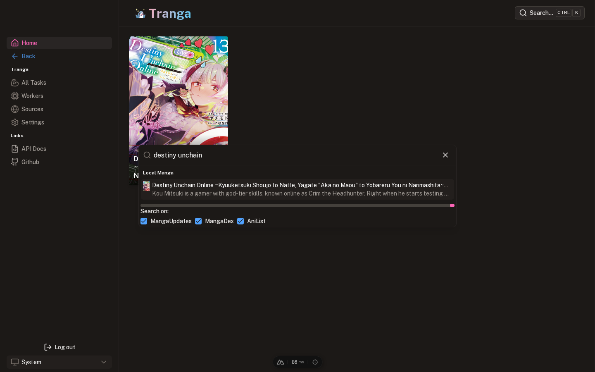
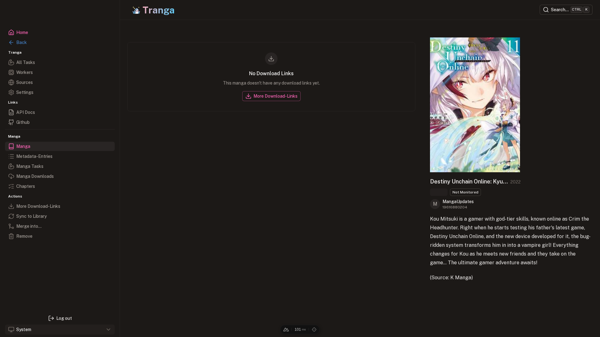
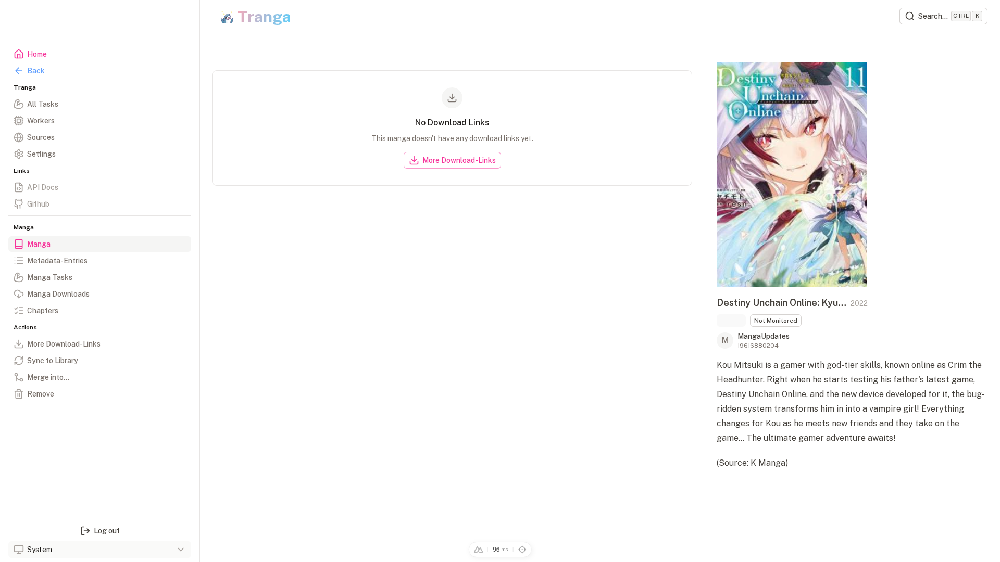
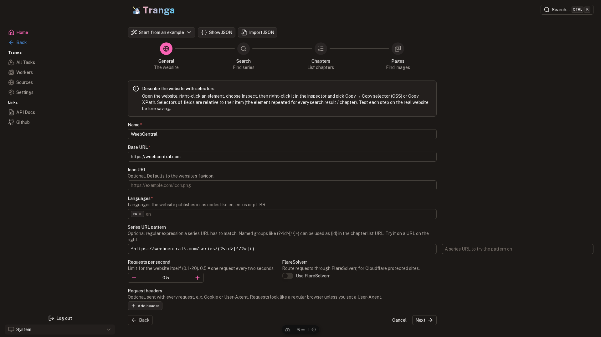
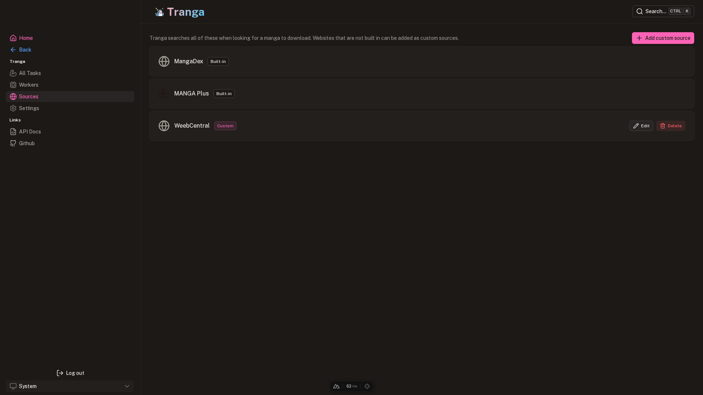
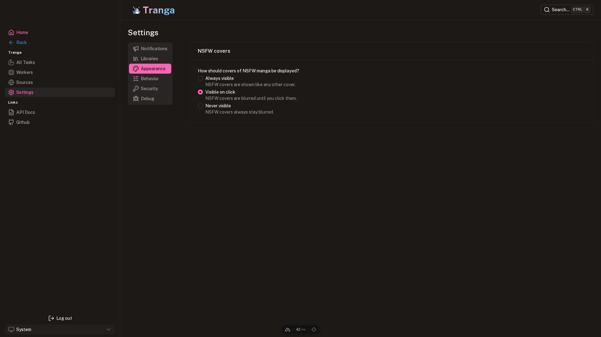

<span id="readme-top"></span>
<div align="center">

  <h1 align="center">Tranga</h1>
  <p align="center">
    Automatic Manga and Metadata downloader 
  </p>


  <table>
    <tr>
      <th></th>
      <td></td>
    </tr>
  </table>

</div>

## Features

- [x] Monitor providers for new chapters and download new ones
- [x] Enrich Manga and chapters with Metadata from third-party websites
- [x] Flaresolverr support
- [x] Notifications
  - Using [Naprise](https://github.com/Genteure/naprise)
    - Gotify
    - Telegram
    - Discord
    - Ntfy.sh
    - ...
- [x] Library support using [Komga](https://komga.org/) and [Kavita](https://www.kavitareader.com/)
  - Sync Metadata
  - Scan chapters
  - Sync Cover images
- [x] Modular download sources (built in: [MangaDex](https://api.mangadex.org/docs/) and [MANGA Plus](https://mangaplus.shueisha.co.jp))
- [x] Custom download sources: add a website with CSS/XPath selectors, no code needed (see [Custom sources](#custom-sources))

#### TODO LIST

- [ ] Unified webpage scraper ([Common/Helpers/RequestClient.cs](Common/Helpers/RequestClient.cs))
- [ ] Existing chapter mapping (`Services.Manga`)

## Getting started

- [docker-compose.yaml](Tranga.AppHost/aspire-output/docker-compose.yaml)
You probably do not want to modify this. Use the [`.env`](Tranga.AppHost/aspire-output/.env) file for configuration.
- [.env](Tranga.AppHost/aspire-output/.env)
  - [Environment variable documentation](EnvVars.md)

### Settings

All configuration that doesn't live in the [`.env`](Tranga.AppHost/aspire-output/.env) file is done in the web UI under **Settings**:

| Page              | What it does                                                                                                                                                                                  |
|-------------------|-----------------------------------------------------------------------------------------------------------------------------------------------------------------------------------------------|
| **Sources**       | See the built-in download sources (MangaDex, MANGA Plus) and add, edit or delete your own custom sources. |
| **Notifications** | Add notification extensions: Gotify, Discord, ntfy.sh, Telegram, or any other [Naprise](https://github.com/Genteure/naprise) service URL.                                                    |
| **Libraries**     | Connect [Komga](https://komga.org/) or [Kavita](https://www.kavitareader.com/) libraries (see [Adding a Komga library](#adding-a-komga-library) and [Adding a Kavita library](#adding-a-kavita-library)).                                         |
| **Appearance**    | Choose how covers of NSFW manga are displayed: always visible, visible on click, or never visible (blurred).                                                                                  |
| **Security**      | Create and revoke API keys (only relevant when `UseAuth` is enabled).                                                                                                                         |
| **About**         | Shows version and git commit of every running service.                                                                                                                                        |

The Settings overview additionally offers **Replay first-download tour** (restarts the guided walkthrough) and
**Backfill ComicInfo for downloaded chapters** (creates a task that adds `ComicInfo.xml` to already downloaded chapters; progress is shown on the Tasks page).

### Custom sources

Websites that are not built in can be added under **Settings → Sources → Add custom source**, without writing any code. The
form explains every step and lets you try it against the real website before you save.

A custom source works by scraping: Tranga fetches a web page (the search results, the chapter list of a series, the page of a
chapter) and picks the data it needs out of the HTML with path matching, i.e. CSS selectors or XPath expressions, optionally
refined with a regular expression. Websites whose pages are empty until JavaScript has loaded the content work too: there the
source reads the JSON of the website's API, with paths (`data`, `manga.title`) in place of selectors. Searching, listing the
chapters and finding the page images are three separate steps, each with its own page and selectors. A source is a small JSON
document, so it can be shared.

Examples to start from (they can also be loaded with **Start from an example** in the form), each mirroring the
[keiyoushi](https://github.com/keiyoushi/extensions-source) extension of the same website:

- [WeebCentral](Extensions/Custom/Examples/weebcentral.json)
- [MangaTown](Extensions/Custom/Examples/mangatown.json)
- [Manga.uno](Extensions/Custom/Examples/mangauno.json) (a JSON API)

A [prompt for AI agents](Extensions/Custom/Examples/agent-prompt.md) lets one write the definition of a website for you
(the form links to it as well).

Good to know:

- The data has to be in what the server sends: the HTML of a page, or the JSON of the API a page loads its content from.
  JavaScript is never run (FlareSolverr only helps with Cloudflare challenges).
- For safety, custom sources may only reach public websites: loopback, LAN and link-local addresses are refused. Set
  `ALLOW_PRIVATE_SOURCE_HOSTS=true` ([EnvVars.md](EnvVars.md)) for a source on your own network.

### Adding a Komga library

When adding a Komga library, the "Library Root Path" must be the path *inside the Komga container*
where Tranga's `Mangas` volume is mounted — not the path on the host, and not the path inside Tranga's own containers.
Mount that same volume into your Komga container and point the field at wherever you mounted it
(defaults to `/tranga` if left blank).

### Adding a Kavita library

Kavita libraries are created in Kavita itself: add a library there whose folder is Tranga's `Mangas` volume
(mounted into your Kavita container). In Tranga, pick **Kavita** as the library type, enter your server's base URL and an
**Auth Key** (Kavita: User Settings → Manage Auth Keys; Kavita 0.9.x or newer), click **Test Connection**, then choose the
Kavita library to bind to. Tranga triggers a Kavita library scan whenever chapters are downloaded or deleted.
Kavita reads series metadata from the `ComicInfo.xml` Tranga writes into each chapter, so Tranga does not push metadata or covers to Kavita.

### Resetting the admin password

If `UseAuth` is enabled and you've forgotten the admin password, or the account is locked out after too many failed logins,
run the `reset-password` tool shipped inside the auth container:

```bash
docker exec -it <auth-container> /app/reset-password
```

It prompts for a new password (input hidden, entered twice to confirm) and clears any active lockout.
Leaving the prompt empty removes the password entirely, putting the deployment back into first-run setup —
the login page will show the setup screen again on next load.

## Screenshots












## Built With

**💙 [Blåhaj](https://www.ikea.com/us/en/p/blahaj-soft-toy-shark-90373590/) 🦈**
- [ASP.NET](https://dotnet.microsoft.com/en-us/apps/aspnet)
  - [EF Core](https://learn.microsoft.com/en-us/ef/core/)
- [PostgreSQL](https://www.postgresql.org/about/licence/)
  - [Ngpsql](https://github.com/npgsql/npgsql/blob/main/LICENSE)
- [Sixlabors.ImageSharp](https://sixlabors.com/products/imagesharp/)
- [FlareSolverr](https://github.com/FlareSolverr/FlareSolverr)
  - [FlareSolverrSharp](https://github.com/FlareSolverr/FlareSolverrSharp)
- [Naprise](https://github.com/Genteure/naprise)
- [GitInfo](https://github.com/devlooped/GitInfo)
- [Git-Describe](https://github.com/tvdstaaij/node-git-describe)
- [xUnit](https://xunit.net/index.html?tabs=cs)
- [XmlSchemaClassGenerator](https://github.com/mganss/XmlSchemaClassGenerator)
- [NSwag](https://github.com/RicoSuter/NSwag)
- [Nuxt](https://nuxt.com/)
  - [Nuxt UI](https://ui.nuxt.com/)
  - [TailwindCSS](https://tailwindcss.com/)
  - [Lucide Icons](https://lucide.dev/)

<p align="right">(<a href="#readme-top">back to top</a>)</p>

## Star History

<a href="https://star-history.dera.page/#c9glax/tranga&Date">
 <picture>
   <source media="(prefers-color-scheme: dark)" srcset="https://star-history.dera.page/svg?repos=c9glax/tranga&type=Date&theme=dark" />
   <source media="(prefers-color-scheme: light)" srcset="https://star-history.dera.page/svg?repos=c9glax/tranga&type=Date" />
   
 </picture>
</a>

### Prerequisits

[.NET 10](https://dotnet.microsoft.com/en-us/download/dotnet/10.0)

### Running locally with Aspire

Tranga uses [.NET Aspire](https://learn.microsoft.com/en-us/dotnet/aspire/) ([Tranga.AppHost/AppHost.cs](Tranga.AppHost/AppHost.cs)) to
orchestrate the full stack (Postgres, RabbitMQ, all services, the frontend and the YARP gateway) for local development:

```bash
dotnet run --project Tranga.AppHost/Tranga.AppHost.csproj
```

This starts everything and opens the Aspire dashboard, from which you can inspect logs, traces and each resource's state.

### Publishing (regenerating docker-compose.yaml)

[docker-compose.yaml](Tranga.AppHost/aspire-output/docker-compose.yaml) is generated from `AppHost.cs` — don't hand-edit it.
Regenerate it with:

```bash
dotnet run --project Tranga.AppHost/Tranga.AppHost.csproj --publisher docker-compose --output-path aspire-output
```

Building the service container images during publish requires a [SixLabors ImageSharp](https://sixlabors.com/pricing/)
license — `Common` depends on ImageSharp, and its license check only tolerates a missing license in Debug builds; the
Release build used for publish fails without one. Supply yours via the `SixLaborsLicenseKey` Aspire parameter:

```bash
Parameters__SixLaborsLicenseKey="$(cat Common/sixlabors.lic)" \
  dotnet run --project Tranga.AppHost/Tranga.AppHost.csproj --publisher docker-compose --output-path aspire-output
```

(`Common/sixlabors.lic` is gitignored — get one from [sixlabors.com/pricing](https://sixlabors.com/pricing/) and drop it there,
or pass the license string directly.)

> Aspire caches resolved publish parameter values per-deployment under `~/.aspire/deployments/*/development.json`. If you
> change the license value and a re-run doesn't seem to pick it up, edit that file directly or delete it to force
> re-resolution.

<!-- CONTRIBUTING -->
## Contributing

If you want to contribute, please feel free to fork and create a Pull-Request!

Please read [CONTRIBUTING](CONTRIBUTING.md)

The frontend can be translated, see [Frontend/TRANSLATING.md](Frontend/TRANSLATING.md).

## License

Distributed under the GNU GPLv3 License. See [LICENSE](https://github.com/C9Glax/tranga/blob/main/LICENSE) for more information.

## Acknowledgments

* [Choose an Open Source License](https://choosealicense.com)
* [Best-README-Template](https://github.com/othneildrew/Best-README-Template/tree/master)
* [Shields.io](https://shields.io/)
